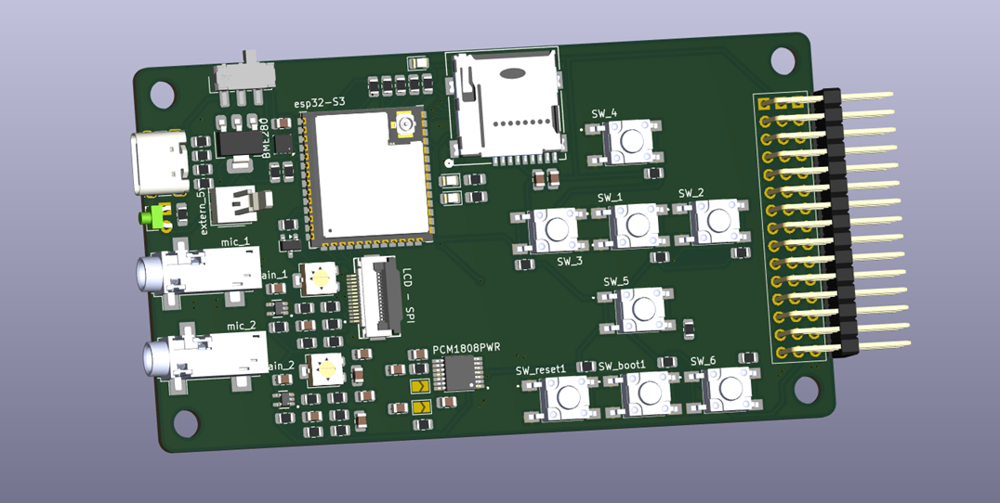

# KynoWave

O **KynoWave** é um projeto de hardware focado na monitorização de ruído acústico em ambientes. Desenvolvido em torno do microcontrolador ESP32-S3. 

O projeto foi desenvolvido para participar do desafio da Maratona de Inovação 2026/1, realizada no evento Arena Ação Jr.

Todo o desenvolvimento de hardware e software foi realizado em menos de um mês, dentro do prazo proposto pelo desafio, e o projeto conquistou o 2º lugar na competição.

## Características Principais

* **Microcontrolador:** ESP32-S3.
* **Entradas de Áudio:** Capacidade para a ligação de até 2 microfones, com ganho ajustável entre 2x e 22x.
* **Filtro Anti-aliasing:** Filtro anti-aliasing configurado para 100kHz.
* **Ecrã LCD:** Conexão otimizada via cabo flat (FPC) para interface SPI com ecrã LCD.
* **Sensores Ambientais:** Integração com sensores de pressão, temperatura e humidade.
* **Armazenamento Local:** Interface para cartão de memória usando conexão SPI.
* **Expansibilidade:** Disponibilização de 15 GPIOs genéricos através de um conector lateral. Estes pinos permitem a adição de sensores extra e suportam integração com módulos de câmara e sensores i2c.

Abaixo, a fotografia detalhada da PCB:

---
